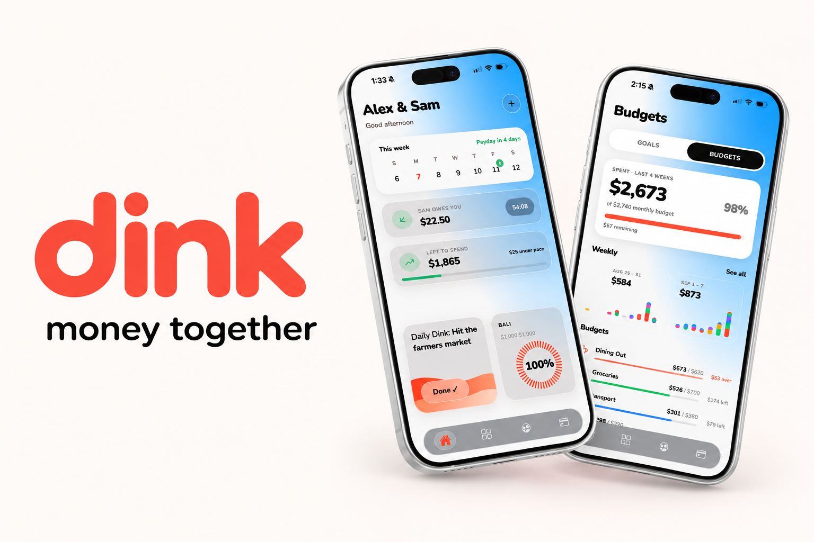

# Gavin Sturm

### Forward Deployed Engineer

I build AI-native systems that move beyond prototypes and into production.

Working across applied AI, backend engineering, infrastructure, and complex enterprise workflows. I enjoy taking ambiguous problems, getting close to the people experiencing them, and engineering systems that actually make a difference.

  <a href="https://www.linkedin.com/in/gavin-sturm-9bb34a213">LinkedIn</a>
  &nbsp;·&nbsp;
  <a href="https://gavindsturm.github.io/gavinsturm_portfolio/">Portfolio</a>
  &nbsp;·&nbsp;
  <a href="mailto:gavindarrellsturm@gmail.com">Email</a>

---

## 01 / CURRENTLY BUILDING

<table>
<tr>
<td width="100%" bgcolor="#0d1117">
VERTEX / ENTERPRISE AI / GLOBAL TAX TECHNOLOGY

# Vertex

### AI-Native Global Tax & Compliance Platform

Building a full-scale AI-native platform for global tax and compliance, bringing intelligent capabilities into complex enterprise workflows.

</td>
</tr>
</table>

## 02 / SELECTED ENGINEERING WORK

<table>
<tr>
<td width="50%" valign="top" bgcolor="#0d1117">
LOGISTICS / AI AUTOMATION

### Intelligent Email Operations

Built an AI-powered email automation pipeline managing thousands of concurrent email threads and streamlining operational workflows.

Worked directly with operations leadership during a period of **183% revenue growth in Q1 2026**.

</td>
<td width="50%" valign="top" bgcolor="#0d1117">
HEALTHCARE / DATA ENGINEERING

### Clinical Data Migration

Engineered a HIPAA-compliant pipeline supporting the migration of **30,000+ medical records** into a live clinical environment.

Built around encryption, audit logging, and least-privilege access to protected health information.

</td>
</tr>
<tr>
<td width="50%" valign="top" bgcolor="#0d1117">
LEAPING AI / VOICE AI

### Conversational Voice AI

Built voice AI pipelines enabling natural customer conversations and connecting AI interactions to real operational workflows.

</td>
<td width="50%" valign="top" bgcolor="#0d1117">
DEFENSE / SECURE ENTERPRISE AI

### Air-Gapped Enterprise LLM

Deployed an air-gapped LLM for natural-language ERP querying, with scoped SQL access, Active Directory authentication, MFA, SIEM audit logging, TLS, and **13 CMMC Level 2 controls**.

</td>
</tr>
</table>

---

## 03 / INDEPENDENT PRODUCT

<table>
<tr>
<td width="50%" valign="middle">

CO-FOUNDED PRODUCT / APP STORE

# dink

### Money is better together.

A shared financial space designed for couples to manage money, stay organized, and build goals together.

**FEATURES**

- Shared budgets and spending
- Savings goals and progress
- Bill splitting and IOUs
- Money challenges and duels
- Monthly financial recaps

 

</td>
<td width="50%" valign="middle" align="center">

THE DINK APP EXPERIENCE

</td>
</tr>
</table>

---

## 04 / TECHNOLOGY

**Languages**

**Backend, Infrastructure & Frontend**

**AI, Data & Observability**

**Security & Compliance**

---

  <a href="https://www.linkedin.com/in/gavin-sturm-9bb34a213">LinkedIn</a>
  &nbsp;·&nbsp;
  <a href="https://gavindsturm.github.io/gavinsturm_portfolio/">Portfolio</a>
  &nbsp;·&nbsp;
  <a href="mailto:gavindarrellsturm@gmail.com">Email</a>

